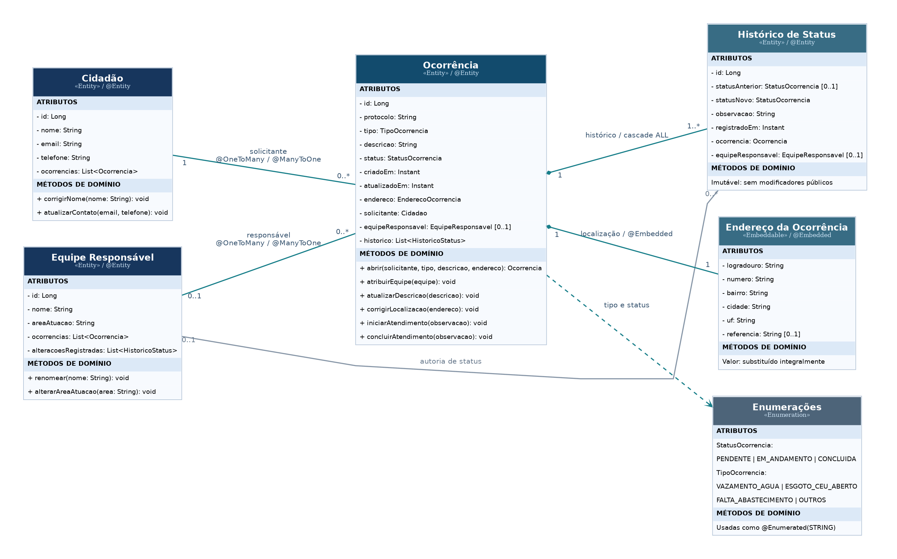

# SaneaTech — Tecnologia para o Saneamento Básico

**Backend Avançado — P4.447 | Ciência da Computação | 2ª entrega: modelagem do domínio e arquitetura**

**Equipe:** Eduardo Cabral · Sérgio Henrique · Leonardo Teixeira · Luca Magalhães · Luís Eduardo Montenegro.

## 1. Descrição e alinhamento com a primeira entrega

A **primeira entrega** do projeto SaneaTech definiu o problema como a falta de um sistema centralizado para registrar e acompanhar ocorrências de saneamento básico, como vazamentos de água, esgoto a céu aberto e falhas no abastecimento. A solução proposta é uma plataforma web na qual **cidadãos cadastram ocorrências** com descrição e localização e **equipes responsáveis acompanham e atualizam seu status**.

O MVP inclui: (1) registro de ocorrências; (2) painel para visualização futura; (3) atualização de status `PENDENTE → EM_ANDAMENTO → CONCLUIDA`. Inteligência artificial, sensores IoT e análises avançadas permanecem **fora do escopo**.

**Escopo desta segunda entrega:** somente **entidades JPA, atributos e tipos, relacionamentos, invariantes/métodos de domínio, diagrama UML, definição arquitetural e testes**. Não há Controllers, Services, APIs, endpoints ou interface web porque **não são exigidos nesta fase**. O painel e a API são funcionalidades propostas para etapas posteriores, não implementadas aqui.

## 2. Tecnologias e execução

- **Java 17** (ou superior, compatível com Java 17)
- **Maven 3.9+** (gerenciador de dependências)
- **Jakarta Persistence API (JPA) 3.1** para o mapeamento de entidades
- **Hibernate ORM 6.6.13.Final** como provedor JPA
- **H2 2.3.232** como banco em memória para demonstração/testes
- **JUnit Jupiter 5.11.4** para testes automatizados

### Pré-requisitos

```bash
java -version
mvn -version
```

O projeto está configurado para compilar usando Java 17. Não é preciso criar um banco, configurar credenciais reais, iniciar servidor nem configurar variáveis de ambiente.

### Rodar testes unitários e teste de persistência

```bash
mvn clean test
```

Os testes cobrem a abertura da ocorrência, fluxo e histórico de status, restrições de edição, vínculo bidirecional com a equipe, validações de dados e persistência/recuperação usando JPA + H2. O teste de persistência cria tabelas temporárias automaticamente.

### Executar demonstração JPA em console

```bash
mvn -q compile exec:java
```

O comando cria um cidadão, uma equipe, uma ocorrência e seus eventos de histórico, persiste os registros no H2 e imprime protocolo, status e quantidade de eventos. O banco `jdbc:h2:mem:saneatech` é **volátil**; ao encerrar a execução, os dados deixam de existir. A demonstração é somente um `main()` para validar a modelagem, não uma camada de aplicação ou API.

### API: cadastro de equipes (`feature/cadastro-equipes`)

```bash
mvn spring-boot:run   # sobe a API em http://localhost:8080

curl -i -X POST http://localhost:8080/equipes \
  -H 'Content-Type: application/json' \
  -d '{"nome": "Equipe de Redes", "areaAtuacao": "Manutenção de água"}'
```

- `CadastroEquipeController` (`apresentacao`) recebe `POST /equipes` com `nome` e `areaAtuacao` e responde `201 Created` com `Location: /equipes/{id}` e o corpo `{id, nome, areaAtuacao}`.
- `CadastroEquipeService` (`aplicacao`) cria a entidade `EquipeResponsavel` já existente (cujo construtor valida e remove espaços extras) e impede nomes duplicados, sem diferenciar maiúsculas/minúsculas.
- Validações: `nome` e `areaAtuacao` obrigatórios, não vazios e com até 120 caracteres → `400`; nome já cadastrado → `409`; JSON malformado → `400`. Erros seguem o formato `ProblemDetail` (RFC 9457).

### Compilar pacote

```bash
mvn clean package
```

## 3. Entidades, atributos e relacionamentos

| Entidade | Atributos de negócio e tipos principais | Responsabilidade |
|---|---|---|
| `Cidadao` | `id: Long`, `nome: String`, `email: String`, `telefone: String`, `ocorrencias: List<Ocorrencia>` | Origem das solicitações; contato e identificação |
| `EquipeResponsavel` | `id: Long`, `nome: String`, `areaAtuacao: String`, `ocorrencias: List<Ocorrencia>`, `alteracoesRegistradas: List<HistoricoStatus>` | Equipe que atende e registra alterações |
| `Ocorrencia` | `id: Long`, `protocolo: String`, `tipo: TipoOcorrencia`, `descricao: String`, `status: StatusOcorrencia`, `criadoEm: Instant`, `atualizadoEm: Instant`, `endereco: EnderecoOcorrencia`, `solicitante: Cidadao`, `equipeResponsavel: EquipeResponsavel`, `historico: List<HistoricoStatus>` | Raiz do agregado; registro, localização, atribuição e transições |
| `HistoricoStatus` | `id: Long`, `statusAnterior: StatusOcorrencia?`, `statusNovo: StatusOcorrencia`, `observacao: String`, `registradoEm: Instant`, `ocorrencia: Ocorrencia`, `equipeResponsavel: EquipeResponsavel?` | Trilha auditável de eventos de status |
| `EnderecoOcorrencia` | `logradouro`, `numero`, `bairro`, `cidade`, `uf`, `referencia`: `String` | **Objeto de valor `@Embeddable`**, não entidade independente |

`TipoOcorrencia`: `VAZAMENTO_AGUA`, `ESGOTO_CEU_ABERTO`, `FALTA_ABASTECIMENTO`, `OUTROS`.

`StatusOcorrencia`: `PENDENTE`, `EM_ANDAMENTO`, `CONCLUIDA`.

### Cardinalidades e JPA

| Relacionamento | Multiplicidade | Mapeamento Java |
|---|---|---|
| `Cidadao` → `Ocorrencia` | 1 cidadão → 0..N ocorrências; cada ocorrência → 1 cidadão | `@OneToMany(mappedBy = "solicitante")` / `@ManyToOne(optional = false)` |
| `EquipeResponsavel` → `Ocorrencia` | 1 equipe → 0..N ocorrências; cada ocorrência → 0..1 equipe | `@OneToMany(mappedBy = "equipeResponsavel")` / `@ManyToOne` |
| `Ocorrencia` → `HistoricoStatus` | 1 ocorrência → 1..N registros no modelo de domínio; cada registro → 1 ocorrência | `@OneToMany(mappedBy = "ocorrencia", cascade = ALL, orphanRemoval = true)` / `@ManyToOne(optional = false)` |
| `EquipeResponsavel` → `HistoricoStatus` | 1 equipe → 0..N alterações; cada alteração → 0..1 equipe | `@OneToMany(mappedBy = "equipeResponsavel")` / `@ManyToOne` |
| `Ocorrencia` → `EnderecoOcorrencia` | 1 → 1 | `@Embedded` / `@Embeddable` e `@AttributeOverrides` |

**Justificativas dos relacionamentos:** não há `@ManyToMany` porque cada ocorrência pertence a um único cidadão e tem no máximo uma equipe responsável em cada instante. Não há `@OneToOne` porque o endereço é um **objeto de valor embutido**, sem identidade ou ciclo de vida independente. O `HistoricoStatus` usa entidade própria porque o registro de mudanças precisa ser preservado e consultável. O `@ManyToOne` é o **lado proprietário** das relações bidirecionais; o outro lado usa `mappedBy`. A coleção do histórico usa *cascade* porque seus registros têm o mesmo ciclo de persistência da ocorrência.

## 4. Modificadores de estado, encapsulamento e regras

| Classe | Operações do domínio | Regras e propósito |
|---|---|---|
| `Cidadao` | `corrigirNome`, `atualizarContato` | Não aceita nome/e-mail vazio nem e-mail inválido |
| `EquipeResponsavel` | `renomear`, `alterarAreaAtuacao` | Exige informações textuais válidas |
| `Ocorrencia` | `abrir`, `atribuirEquipe`, `atualizarDescricao`, `corrigirLocalizacao`, `iniciarAtendimento`, `concluirAtendimento` | Só permite atualizações de conteúdo e atribuição enquanto pendente; exige equipe para iniciar; exige `EM_ANDAMENTO` para concluir |
| `HistoricoStatus` | Nenhum modificador público | Eventos são criados pela ocorrência e não alterados após sua criação |
| `EnderecoOcorrencia` | Nenhum modificador público | Valor substituído integralmente por `corrigirLocalizacao` |

As classes possuem construtor sem argumentos `protected` exigido pelo JPA. Não existem `setStatus`, `setEquipe` nem setters genéricos para mutações significativas. Campos mutáveis são privados; coleções expostas por getters são **não modificáveis**. Um evento inicial `PENDENTE` é criado ao abrir a ocorrência, e cada transição de estado acrescenta um evento ao histórico. Alterações de descrição e endereço não são alterações de status e **não** geram esse tipo de evento.

**Estados permitidos:**

```text
ABERTURA -> PENDENTE -> EM_ANDAMENTO -> CONCLUIDA
                         (equipe exigida)
```

As datas usam `Instant` para representar instantes absolutos, independentes do fuso do servidor. O protocolo é gerado automaticamente como `SAN-<UUID>` e possui índice de unicidade na tabela. O banco também garante unicidade do e-mail do cidadão; a regra de e-mail duplicado entre registros diferentes depende dessa restrição de persistência nesta etapa (não há service de cadastro).

### Exemplo de uso sem API

```java
Cidadao cidadao = new Cidadao("Ana", "ana@exemplo.com", "83999999999");
EquipeResponsavel equipe = new EquipeResponsavel("Rede de Água", "Manutenção");
EnderecoOcorrencia endereco = new EnderecoOcorrencia(
    "Rua A", "123", "Centro", "João Pessoa", "PB", "Perto da praça");
Ocorrencia o = Ocorrencia.abrir(cidadao, TipoOcorrencia.VAZAMENTO_AGUA,
    "Vazamento em via pública", endereco);
o.atribuirEquipe(equipe);
o.iniciarAtendimento("Equipe em deslocamento");
o.concluirAtendimento("Reparo finalizado");
```

## 5. Arquitetura escolhida: monólito em camadas com domínio rico

A arquitetura do projeto é **monolítica em camadas**, separando **domínio**, **persistência/infrastrutura** e, em versões futuras, **aplicação e apresentação**. Nesta entrega, o código efetivamente implementado fica concentrado no **domínio** (entidades, enums e regras de negócio) e na **configuração de persistência JPA**, mais uma classe de demonstração em console e testes.

**Por que essa escolha?**

1. **Necessidades do negócio:** o MVP tem fluxo linear, poucas entidades e uma única área funcional — registro, encaminhamento e acompanhamento de ocorrências. Não há necessidade real de serviços independentes.
2. **Complexidade:** quatro entidades persistentes e um objeto de valor permitem um modelo consistente e de fácil manutenção. Camadas simplificam a evolução futura sem introduzir complexidade acidental de microsserviços ou mensageria.
3. **Equipe:** com cinco integrantes, um projeto Maven único e responsabilidades separadas por pastas facilita revisão de código, testes, branches e aprendizado conjunto.
4. **Regras protegidas:** o comportamento de domínio dentro das entidades reduz o risco de alterações de estado inválidas ou do surgimento de setters indiscriminados.
5. **Evolução:** quando a próxima etapa exigir interface web, o grupo poderá adicionar `aplicacao` (orquestração de casos de uso), `infraestrutura` (acesso a dados) e `apresentacao` (controllers/endpoints), mantendo entidades e invariantes reutilizáveis.

**Limites assumidos:** o projeto não implementa autenticação, autorização real de operadores, validação de existência externa dos endereços, coordenação de equipes, abertura de chamados por API ou painel visual. Esses itens pertencem a futuras etapas e não são necessários para esta modelagem.

## 6. Organização do código

```text
SaneaTech-Backend-Avancado/
├── pom.xml
├── README.md                         # Descrição, arquitetura, execução e regras
├── .gitignore
├── .gitattributes
├── .github/CONTRIBUTING.md           # Colaboração dos cinco integrantes
├── docs/
│   ├── diagrama-classes.png          # UML para Google Sala de Aula
│   ├── diagrama-classes.svg          # UML em vetor
│   ├── diagrama-classes.puml         # UML editável em PlantUML
│   ├── diagrama-classes.dot          # Fonte para gerar PNG/SVG via Graphviz
│   ├── ENTREGA.md                    # Texto e checklist de submissão
│   ├── DECISOES_MODELO.md            # Regras e decisões técnicas
│   └── VALIDACAO.md                  # Registro do que foi testado
├── src/main/
│   ├── java/br/edu/p447/saneatech/
│   │   ├── AplicacaoDemonstracao.java
│   │   └── dominio/
│   │       ├── modelo/              # @Entity, @Embeddable, métodos de domínio
│   │       ├── enums/               # StatusOcorrencia, TipoOcorrencia
│   │       └── excecao/             # RegraNegocioException
│   └── resources/META-INF/persistence.xml
└── src/test/java/br/edu/p447/saneatech/
    ├── dominio/OcorrenciaTest.java
    └── infra/PersistenciaJpaTest.java
```

**Organização planejada para outra fase (não implementada):**

```text
aplicacao/             # casos de uso, coordenação de operações
infraestrutura/        # implementações concretas de repositórios
apresentacao/          # controllers HTTP / endpoints
```

O registro de verificações executadas e limitações do ambiente está em [`docs/VALIDACAO.md`](docs/VALIDACAO.md).

## 7. Diagrama de classes UML

Veja [`docs/diagrama-classes.png`](docs/diagrama-classes.png), [`docs/diagrama-classes.svg`](docs/diagrama-classes.svg) e a fonte editável [`docs/diagrama-classes.puml`](docs/diagrama-classes.puml). O diagrama identifica entidades, atributos/tipos, métodos de domínio e multiplicidades. O `EnderecoOcorrencia` está indicado como `«Embeddable»` e os enums são declarados; as mesmas relações estão implementadas por JPA.



Para editar o diagrama, abra `docs/diagrama-classes.puml` em uma ferramenta compatível com PlantUML. Também há `docs/diagrama-classes.dot` para regenerar as imagens usando Graphviz (`dot -Tpng ...` e `dot -Tsvg ...`).

## 8. GitHub e entrega no Google Sala de Aula

Para publicar (substitua `<URL-DO-REPOSITORIO>` pelo endereço real da equipe):

```bash
git init
git add .
git commit -m "Entrega 2 - dominio JPA UML e arquitetura SaneaTech"
git branch -M main
git remote add origin <URL-DO-REPOSITORIO>
git push -u origin main
```

O repositório precisa conter **todo o código, este README e o UML**. Conceda acesso aos integrantes do grupo no GitHub. No Google Sala de Aula, entregue o **link público/compartilhável do repositório e o arquivo `docs/diagrama-classes.png`**, conforme solicitado. A justificativa arquitetural já está nesta seção 5 do README; o modelo de texto e conferência está em [`docs/ENTREGA.md`](docs/ENTREGA.md).

---

**Trabalho elaborado por:** Eduardo Cabral; Sérgio Henrique; Leonardo Teixeira; Luca Magalhães; Luís Eduardo Montenegro.  
**Disciplina:** Backend Avançado — P4.447 — Ciência da Computação.  
**Data:** 18 de novembro de 2026.
# SaneaTech
